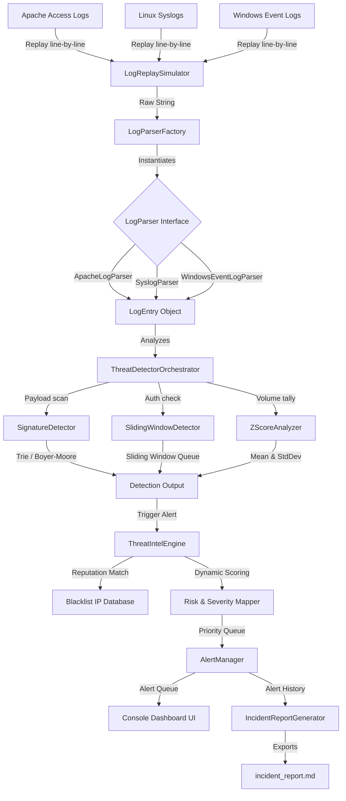
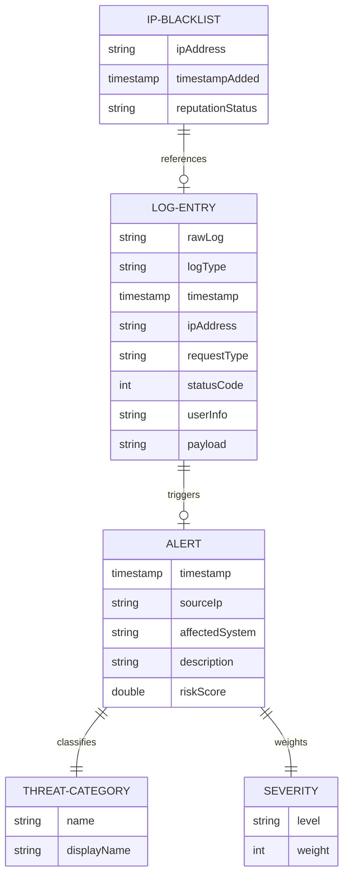

# UML and Architecture Diagrams

This document contains text-based UML and Architecture diagrams for the **Adaptive Cybersecurity Threat Intelligence Engine**. These diagrams are formatted using Mermaid syntax, which can be rendered directly by Markdown viewers (like GitHub, GitLab, or VS Code), or converted to images.

---

## 1. System Architecture Diagram

This diagram maps out the data flow from raw security logs through parsing, analysis, detection algorithms, threat intel scoring, queuing, and reporting.



---

## 2. UML Class Diagram

This diagram displays the object-oriented structure of the system, showcasing SOLID principles and design patterns (Factory, Observer).

```mermaid
classDiagram
    %% Core Model Layer
    class Severity {
        <<enumeration>>
        LOW
        MEDIUM
        HIGH
        CRITICAL
    }

    class ThreatCategory {
        <<enumeration>>
        SQL_INJECTION
        XSS_ATTACK
        COMMAND_INJECTION
        DIRECTORY_TRAVERSAL
        MALICIOUS_URL
        BRUTE_FORCE
        SUSPICIOUS_IP
        TRAFFIC_ANOMALY
        SUSPICIOUS_BEHAVIOR
        -displayName: String
        +getDisplayName() String
    }

    class LogEntry {
        -rawLog: String
        -logType: String
        -timestamp: LocalDateTime
        -ipAddress: String
        -requestType: String
        -statusCode: int
        -userInfo: String
        -payload: String
        +toString() String
    }

    class Alert {
        -timestamp: LocalDateTime
        -category: ThreatCategory
        -severity: Severity
        -sourceIp: String
        -affectedSystem: String
        -description: String
        -triggeringLog: LogEntry
        -riskScore: double
        +getSeverityWeight() int
        +compareTo(other: Alert) int
        +toString() String
    }

    %% Parser Layer
    class LogParser {
        <<interface>>
        +parse(rawLogLine: String) LogEntry
    }

    class ApacheLogParser {
        -APACHE_PATTERN: Pattern
        -DATE_FORMATTER: DateTimeFormatter
        +parse(rawLogLine: String) LogEntry
    }

    class SyslogParser {
        -SYSLOG_PATTERN: Pattern
        -IP_PATTERN: Pattern
        -USER_PATTERN: Pattern
        +parse(rawLogLine: String) LogEntry
    }

    class WindowsEventLogParser {
        -DATE_FORMATTER: DateTimeFormatter
        -IP_PATTERN: Pattern
        -ACCOUNT_NAME_PATTERN: Pattern
        +parse(rawLogLine: String) LogEntry
    }

    class LogParserFactory {
        +getParser(logType: String) LogParser
    }

    LogParser <|.. ApacheLogParser
    LogParser <|.. SyslogParser
    LogParser <|.. WindowsEventLogParser
    LogParserFactory ..> LogParser : creates

    %% Custom Data Structures
    class Trie {
        -root: TrieNode
        +insert(pattern: String, category: ThreatCategory)
        +searchPrefixOf(text: String) ThreatCategory
        +searchAnySubstringPrefix(text: String) ThreatCategory
    }

    class BoyerMooreMatcher {
        -pattern: String
        -badCharMap: Map
        +search(text: String) int
    }

    %% Detection Layer
    class SignatureDetector {
        -pathTrie: Trie
        -bmVectors: List
        +scan(entry: LogEntry) DetectionResult
    }

    class SlidingWindowDetector {
        -ipFailuresMap: Map
        -userFailuresMap: Map
        -timeWindowSeconds: int
        -failureThreshold: int
        +scan(entry: LogEntry) Result
    }

    class ZScoreAnalyzer {
        -baselineHistory: List
        -zScoreThreshold: double
        -currentBucketStart: LocalDateTime
        -currentBucketCount: int
        +analyze(entry: LogEntry) AnomalyResult
    }

    class ThreatIntelEngine {
        -blacklistedIPs: Set
        +isBlacklisted(ip: String) boolean
        +addIPToBlacklist(ip: String)
        +calculateRiskScore(entry: LogEntry, cat: ThreatCategory, isBl: boolean) double
        +mapRiskToSeverity(riskScore: double) Severity
    }

    class ThreatDetectorOrchestrator {
        -signatureDetector: SignatureDetector
        -slidingWindowDetector: SlidingWindowDetector
        -zScoreAnalyzer: ZScoreAnalyzer
        -threatIntelEngine: ThreatIntelEngine
        +analyze(entry: LogEntry) Alert
    }

    ThreatDetectorOrchestrator --> SignatureDetector
    ThreatDetectorOrchestrator --> SlidingWindowDetector
    ThreatDetectorOrchestrator --> ZScoreAnalyzer
    ThreatDetectorOrchestrator --> ThreatIntelEngine
    SignatureDetector --> Trie
    SignatureDetector --> BoyerMooreMatcher

    %% Alerting & Reporting
    class AlertManager {
        -alertQueue: PriorityBlockingQueue
        -alertHistory: List
        -categoryCounters: Map
        -severityCounters: Map
        +addAlert(alert: Alert)
        +pollAlert() Alert
        +getAlertHistory() List
        +getPendingAlertsSorted() List
    }

    class IncidentReportGenerator {
        +generateMarkdownReport(alerts: List, path: String)
    }

    %% Simulation Engine & Orchestration
    class LogReplaySimulator {
        -logResourcePath: String
        -logType: String
        -orchestrator: ThreatDetectorOrchestrator
        -alertManager: AlertManager
        -listeners: List
        -running: AtomicBoolean
        +start()
        +stop()
    }

    class Main {
        -orchestrator: ThreatDetectorOrchestrator
        -alertManager: AlertManager
        -currentSimulator: LogReplaySimulator
        +main(args: String[])
    }

    LogReplaySimulator --> ThreatDetectorOrchestrator
    LogReplaySimulator --> AlertManager
    Main --> ThreatDetectorOrchestrator
    Main --> AlertManager
    Main --> LogReplaySimulator
    LogEntry --> Alert
    Alert --> Severity
    Alert --> ThreatCategory
    AlertManager --> Alert : manages
    IncidentReportGenerator ..> Alert : processes
```



---

## 3. Use Case Diagram

This diagram displays how the Security Analyst interacts with the console dashboard and the underlying automated modules.

```mermaid
leftToRightDirection
actor "Security Analyst" as Analyst
actor "Log Generator / Server Daemon" as SyslogDaemon

rectangle "Threat Intelligence Engine (ATIE)" {
    usecase "Configure Log Replay File" as UC1
    usecase "Simulate Live Log Monitoring" as UC2
    usecase "Modify Detection Thresholds" as UC3
    usecase "Inspect IP Reputation Blacklist" as UC4
    usecase "Analyze Live Alerts Dashboard" as UC5
    usecase "Export Security Incident Report" as UC6
    usecase "Ingest Security Event Stream" as UC7
    usecase "Auto-Blacklist High Severity IP" as UC8
}

Analyst --> UC1
Analyst --> UC2
Analyst --> UC3
Analyst --> UC4
Analyst --> UC5
Analyst --> UC6

SyslogDaemon --> UC7
UC2 ..> UC7 : includes
UC7 ..> UC8 : triggers (extension)
```

---

## 4. Entity-Relationship (ER) Diagram (Logical Representation)

Since the system runs in-memory and interfaces via flat-files, this diagram models the logical relationships of data components inside the program.


